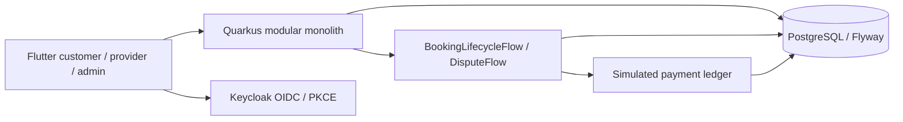

# Bliss V2

A local-services marketplace connecting customers with individual professionals
and companies. Rebuilding the preserved prototype as a Java 21 / Quarkus modular
monolith with PostgreSQL and a Flutter client.

**Status: web, Android and iOS simulator request-to-review flows verified; secondary iOS acceptance remains open.**

Implemented: public category/provider/offering discovery backed by Flyway and
PostgreSQL, a Flutter HTTP catalog client, bounded pagination, health/metrics,
OpenAPI, tests and GitHub Actions. Keycloak sign-in, authenticated profiles and
provider onboarding, owned service publishing/editing/archiving, and Flutter
business management are implemented with ownership/version checks. Request/quote
APIs atomically create a booking on acceptance, with concurrency and ownership tests.
BookingLifecycleFlow now coordinates persisted human actions, provider deadlines,
retry/compensation and idempotent simulated settlement. Protected history/payment
reads and forced-process restart tests cover recovery. Customers can also book a
published offering directly through the API, with an immutable scope/price snapshot
and protection against stale prices and duplicate submissions. Flutter now connects
customer requests, provider quotes, direct booking, scheduling, lifecycle actions,
and the booking/payment timeline. The web demo is verified against the real local
API. Persisted booking conversations now support participant-only chat, polling,
older-message pagination and safe send retries. Completed bookings support one
customer review, with public provider ratings and comments. Disputes now collect
private evidence and wait for an independent admin decision before simulated
refund, void or capture. Real Android browser login, process-death session recovery,
logout and account switching are verified. The iOS simulator build and native
session fixture pass. Real iOS browser login, recovery, logout and account switching
also pass. The iOS request-to-review flow now passes; secondary native paths remain open.
See the [marketplace demo](docs/demo/MARKETPLACE.md) for steps and evidence.
The [Android marketplace run](docs/demo/ANDROID_MARKETPLACE.md) verifies the native
request, quote, booking, chat, completion and review flow with real local services.
The [secondary Android checks](docs/demo/ANDROID_SECONDARY.md) verify direct booking
cancellation, customer/provider/admin disputes and catalog connection recovery.
The [iOS simulator gate](docs/demo/IOS.md) verifies compilation, callback
registration, Keychain persistence, refresh/rotation and local logout using
synthetic tokens in three app processes.
The separate [iOS browser run](docs/demo/IOS_AUTH.md) verifies real Keycloak
customer/provider authentication against an isolated PostgreSQL/Bliss API stack.
The [iOS marketplace run](docs/demo/IOS_MARKETPLACE.md) verifies request, quote,
booking, two-way chat, scheduled work, simulated capture and saved-review recovery.
The [chat demo](docs/demo/CHAT.md) records both participants and restart persistence.
See the [reviews demo](docs/demo/REVIEWS.md) for eligibility and public-rating checks.
See the [dispute demo](docs/demo/DISPUTES.md) for manual decisions and recovery checks.


Use the [8–10 minute walkthrough](docs/product/PORTFOLIO_DEMO.md#timed-web-walkthrough)
and [release evidence checklist](docs/product/RELEASE_CHECKLIST.md) to present the
working scope and remaining limits. No real payments or public deployment.

## Run locally

Requirements: Java 21, Docker with a working Linux engine, and Flutter 3.47.5.
Maven 3.9.11 is supplied by the wrapper. PostgreSQL 17.6 is pinned in Compose.
Quarkus core 3.39.0 and Flow 1.2.0.CR1 match the inspected upstream version;
the release-candidate dependency will be reevaluated before product beta.

1. Copy `.env.example` to `.env` and replace its password placeholder.
2. On Windows, run:

   ```powershell
   ./infrastructure/scripts/dev-api.ps1 -JavaHome 'C:\Program Files\Java\jdk-21'
   ```

   On macOS/Linux, export the three `BLISS_DB_*` values from your local `.env`,
   run `pwsh infrastructure/scripts/prepare-local-auth.ps1` (PowerShell 7),
   `docker compose up -d --wait`, then:

   ```sh
   cd services/api
   ./mvnw clean quarkus:dev -Dquarkus.profile=local
   ```

3. In another terminal:

   ```sh
   cd apps/mobile
   flutter pub get
   flutter run -d chrome --web-port 3000 --dart-define=API_BASE_URL=http://localhost:8088
   ```

The `local` profile loads explicitly marked sample offerings. Production uses
only reference categories; never reuse the local-demo database for production.
`dev-api.ps1` starts Docker, prepares the generated demo identities, waits for
PostgreSQL/Keycloak, and starts Quarkus. The frontend runs in the second terminal.
Keep those terminals open; stop their foreground processes with Ctrl+C before
running Maven verification (dev mode and tests share the API build directory).
Create a provider-owned business once through Your account → Manage your business;
the sample catalog alone does not grant a demo user ownership of a provider.
On this workstation the ignored SDK is `.tools/flutter/bin/flutter.bat`.
For Android emulator networking, see [mobile setup](apps/mobile/README.md).

- API: [categories](http://localhost:8088/api/v1/categories), [offerings](http://localhost:8088/api/v1/offerings)
- Operations: [readiness](http://localhost:8088/q/health/ready), [metrics](http://localhost:8088/q/metrics)
- Documentation: [Swagger](http://localhost:8088/q/swagger-ui), [Dev UI](http://localhost:8088/q/dev-ui)

Stop infrastructure with `docker compose stop`; data stays in the named volume.
No destructive reset is required for normal development.

Sign in through **Your account**. Local usernames are `customer`, `provider`,
`outsider` and `admin`; generated passwords are in the ignored
`.work/demo-accounts.json`. The provider also has customer capability. Credentials
are generated once and realm import never overwrites an existing realm.
Keycloak runs only on loopback port 8180. See [authentication setup](docs/architecture/ADR-003-authentication.md).

## Verify

```sh
cd services/api
./mvnw verify
./mvnw spotless:apply  # only when formatting Java changes
cd ../../apps/mobile
dart format --output=none --set-exit-if-changed lib test
flutter analyze
flutter test
```

Tests use a real PostgreSQL Dev Service when Docker is available. To use an
existing **dedicated test database**, supply `QUARKUS_DATASOURCE_JDBC_URL`,
`QUARKUS_DATASOURCE_USERNAME` and `QUARKUS_DATASOURCE_PASSWORD`. Tests apply demo
migrations; do not point them at production or another application's database.
CI provisions an ephemeral PostgreSQL service and runs the same checks. Maven
verify also requires Docker for an isolated restart test: it starts a packaged API,
kills it while a booking waits, restarts against the same database and checks the
original workflow ID and single simulated settlement. Logs are under
`services/api/target/restart-check-server.log`.

On this workstation, Docker Desktop was upgraded to 4.91.0. A Windows stale-socket
problem still affects normal Desktop restarts. The Windows startup helper detects
a stopped engine and preserves its runtime socket folders before starting Desktop;
it never deletes data volumes. If a Docker crash dialog is open, quit Desktop and
rerun the helper. Local PostgreSQL, API readiness, backend integration tests and
live Flutter catalog browsing have been verified. Bliss defaults to
database port 5433 and API port 8088 to coexist with other local projects.
See [progress](docs/agent/PROGRESS.md) for evidence.

## Structure

`apps/mobile` contains the Flutter client. `services/api` contains the Quarkus
modular monolith organized by capability. `infrastructure` contains local startup
scripts. `docs` records product scope, architecture decisions and execution state.

The core process is request → quote → booking → service → confirmation or
dispute → simulated settlement. Standard offerings also support direct booking.
Quarkus Flow coordinates the long waits, timeouts, retries and payment compensation;
the relational domain remains authoritative for API reads.
See [workflow design and the release-specific JPA compatibility fix](docs/architecture/WORKFLOWS.md).
See [database invariants and upgrade preflight](docs/architecture/DATABASE_INVARIANTS.md)
before applying schema changes to an existing database.
Run one local API worker; this slice does not support distributed workflow ownership.



- [Reconnaissance](docs/agent/RECONNAISSANCE.md)
- [Execution plan](docs/agent/PLAN.md)
- [Progress and validation](docs/agent/PROGRESS.md)
- [Operations readiness and bounded smoke](docs/operations/READINESS.md)
- [GitHub backlog](https://github.com/Stuaarts/Bliss/issues)

The original `Bliss-*` folders and `quarkus-flow` are preserved local references,
excluded from this repository. The upstream checkout must not be edited.

License: not yet selected. No license grant is implied; resolve before public release.
