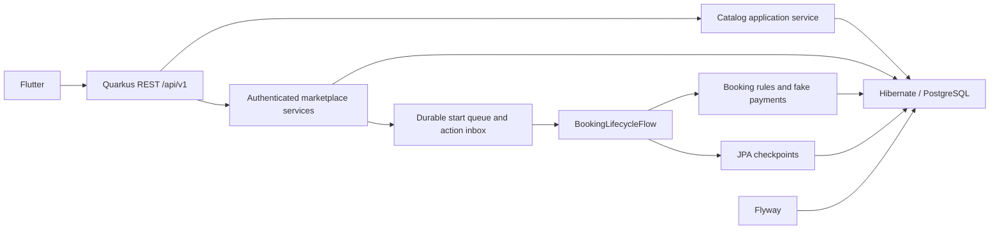

# Architecture

A modular monolith is the V2 deployment unit. Current capabilities: catalog,
OIDC identity, provider management, requests/quotes, durable bookings and simulated
payments. REST DTOs do not expose ORM entities.
The Flutter application uses a configurable HTTP boundary and typed responses.

Authenticated application services own domain transactions. Quarkus Flow
coordinates long-running transitions; it never replaces queryable booking records.
OIDC validates tokens and membership checks enforce resource ownership. External
payment effects sit behind a PaymentGateway; the portfolio adapter is fake.

No broker or cache is needed for the first slice. Adopt transactional event
publication only with a demonstrated reliability requirement and tests.

Quarkus core 3.39.0 / Flow 1.2.0.CR1 are pinned to the locally inspected reference.
Upstream source remains external and excluded. JPA workflow schema validation and
forced-process restoration are tested. The local deployment runs one API worker;
see [workflow durability and compatibility limits](WORKFLOWS.md).
