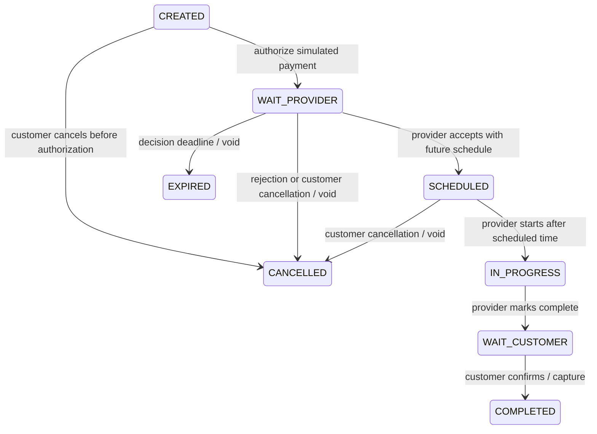

# Durable booking lifecycle

`BookingLifecycleFlow` uses the released Flow 1.2.0.CR1 Java DSL and PostgreSQL/JPA
checkpoints. V5 follows that release's persistence schema; Hibernate validates it
using the documented camel-case-to-underscores naming strategy. Catalog/profile
CRUD remains ordinary application services.

Quote acceptance and direct offering booking share `BookingCreation`, inserting a
durable start request in the same transaction as the snapshot/history/audit. A
dispatcher claims it under the booking lock, stores the canonical engine
instance ID, commits, then starts the instance. A crash before engine persistence
leaves a claim recoverable after 30 seconds. Existing checkpoints belong to the
engine's startup restoration; the dispatcher never starts a replacement for them.
Every domain step checks the canonical instance ID to neutralize abandoned starts.

Authorized HTTP actions commit to a PostgreSQL inbox and return 202. Flow waits
for two seconds using its durable timer, then calls a thin domain step. This local
adapter provides durable correlation without a broker; it polls the inbox rather
than publishing CloudEvents. One pending action per booking prevents ambiguous
simultaneous decisions. A booking lock serializes action admission and processing.
The domain transition, event acknowledgment, status history, audit entry and fake
payment ledger commit together. Replayed steps and duplicate action UUIDs are safe.
The action admission timestamp is stored explicitly so replay uses the same
schedule/deadline decision, including actions admitted just before a timeout.

Demo policy: provider decisions expire after `bliss.booking.provider-decision-seconds`
(default 86400). Schedules must be future UTC timestamps, at most microsecond
precision. Starting requires reaching that schedule. Customer cancellation is
allowed through SCHEDULED, but not after work starts. Customer confirmation waits
indefinitely: absence of a response never triggers an automatic capture. These
are local simulation policies, not approved commercial cancellation/payment terms.

`PaymentGateway` isolates the side-effect boundary. `FakePaymentGateway` implements
AUTHORIZE, CAPTURE, VOID and REFUND with a unique booking/operation ledger key.
No card data, payment credentials or external money movement exists. REFUND is
verified at the adapter boundary; dispute/refund endpoints remain issue #10.
Transient payment/persistence failures retry up to three times after the initial
attempt, with a 250 ms base delay. Exhaustion faults the workflow for diagnosis;
automated operator recovery and real-provider reconciliation remain hardening work.

## Release-specific compatibility fix

The forced-restart test reproduced a defect in Flow 1.2.0.CR1: JPA writes a row for
each task iteration, but restoration builds a map keyed only by task pointer and
throws `Duplicate key do/0/advanceBooking` after multiple loop iterations.
`LoopSafeJpaOperations`, a Bliss-local CDI alternative, retains the newest completed
iteration for each task in the same engine transaction. It matches the reader's
one-checkpoint-per-task contract and bounds the three-task loop's checkpoint rows.
The upstream checkout is unchanged. Keep the restart regression when upgrading;
remove the adapter only after the upstream release passes it independently.
The adapter also materializes the startup scan and closes its transaction before
returning instances to the asynchronous restorer. Otherwise the release propagates
the scan transaction into worker threads, producing Narayana concurrent-transaction
warnings and rollback during startup. The scan is intentionally in-memory for the
local portfolio workload; large deployments need paged restoration. Follow-up: #22.

## Verification and operating limits

`BookingWorkflowTest` exercises actual Flow execution, completion/capture, repeated
events, cancellation, rejection/void, provider timeout, transient retry, abandoned
start recovery, ownership checks and history/payment visibility. `WorkflowRestartIT`
runs during Maven verify: an isolated PostgreSQL container and a packaged API are
started, waiting loops checkpoint, and the API is forcibly killed. The same database
restores the same instance, then rejection or completion verifies a single settlement.
The completion case starts from a direct offering booking and also crashes while
waiting for the customer; the rejection case starts from a quote. This is a real
process test, not a mock restoration call.

Run one API worker against this local database. Multi-replica workflow ownership,
distributed leases, dead-letter/operator tooling, retention and real payment
outbox/reconciliation are outside this portfolio slice. Do not roll back V5 while
instances exist or change workflow identity/version without a migration plan.
History, payment and execution endpoints enforce booking ownership. Execution
status exposes engine state without stack traces or other users' data.

DisputeFlow (#10) remains planned: evidence → manual admin review → authorized
refund/void or capture → resolution. No automated adjudication.
