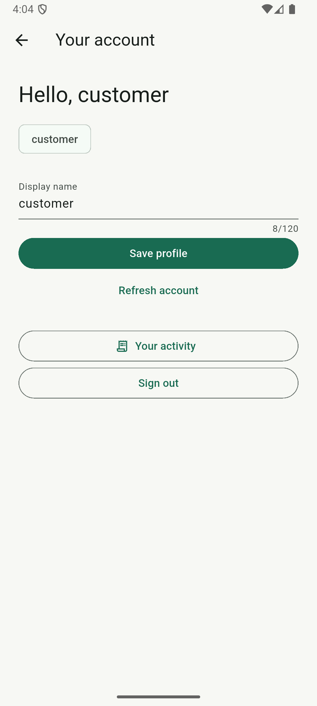
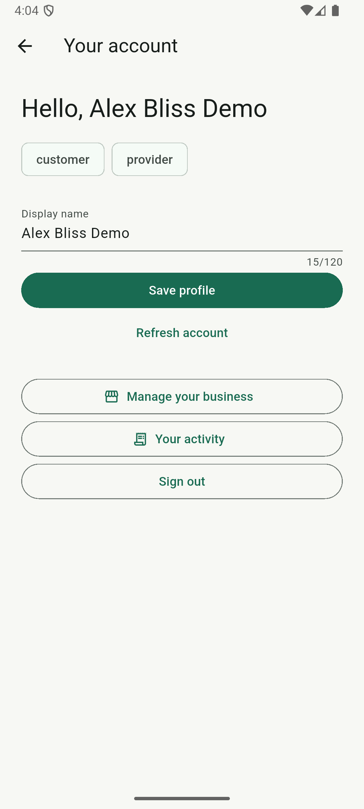
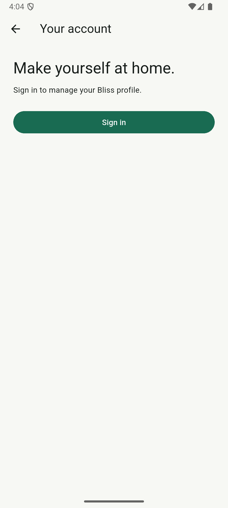

# Android authentication and emulator verification

Verified September 27, 2026 on Windows with Flutter 3.47.5, Java 21 and the
installed Android API 36 Google Play x86_64 image. The debug app passes real
Keycloak browser login, session recovery after process death, logout and account
switching on the dedicated Bliss_Test emulator. The later
[native request-to-review run](ANDROID_MARKETPLACE.md) verifies the primary
marketplace lifecycle. iOS and secondary native paths remain open under #7.

## Real Keycloak browser regression

The first two real-login runs reached the AppAuth redirect receiver but remained
in Chrome without showing the authenticated profile. Removing the empty
`android:taskAffinity` from MainActivity fixed the return to Bliss, consistent
with [AppAuth's Android troubleshooting guidance](https://pub.dev/packages/flutter_appauth/versions/12.1.0#troubleshooting).
The same device test then passed in 51.818 seconds. It verified:

- Customer browser login and authenticated API profile, without provider controls.
- Customer session restoration after force-stop, without another browser login.
- Logout followed by process restart remains signed out.
- Provider login requires fresh browser credentials and exposes provider controls.
- Provider session restoration after force-stop.
- Provider logout, switch back to customer without provider controls, and final
  logout/restart leaves Bliss signed out.

The standalone `android/native_smoke` UiAutomator driver runs outside Bliss so
force-stop actually kills its Flutter process. The driver uses real AppAuth,
secure storage, Chrome, Keycloak and API responses. Dependencies are test-only;
the driver is a separate APK and is not included in the marketplace app.

Start the backend following the root README and boot a dedicated emulator named
`Bliss_Test` with Chrome installed. Both generated demo identities must already
have Bliss profiles (sign into each once, as in the marketplace demo). From the
repository root, using PowerShell 7:

```powershell
./infrastructure/scripts/test-android-oidc.ps1 -DeviceId emulator-5554 `
    -JavaHome 'C:\Program Files\Java\jdk-21'
```

The runner refuses physical devices and other AVD names, checks local services,
builds and installs the app/driver, and reverses ports 8088/8180. It reads generated
demo credentials privately from `.work/demo-accounts.json` and current display
names from local PostgreSQL. Credentials are staged only for the test, never put
in command arguments, and removed from host/device in `finally`. The driver checks
the local Keycloak URL and Bliss realm before entering them. It stops Chrome and
Bliss but does not clear their data; use only the dedicated demo emulator.

Results and app-only screenshots are kept under ignored `.work/native-oidc`.
Success requires `OK (1 test)` plus the account-switch checkpoint; an exit code
alone is insufficient because Android instrumentation can return zero on failure.
The host bounds instrumentation to four minutes. On failure inspect the local
logs before repeating. A successful test leaves Bliss signed out. CI compiles the
app and driver on Linux; it does not execute this local emulator/Keycloak gate.

Actual emulator evidence (September 27, 2026):

| Customer restored after process death | Provider signed in | Signed out after restart |
| --- | --- | --- |
|  |  |  |

## Initial build and startup results

- `flutter build apk --debug` passed. Gradle installed NDK 28.2.13676358, Android
  Platform 35 (required by a plugin) and CMake 3.22.1 using existing SDK license
  acceptance. No license hashes were fabricated or new acceptance entered.
- The existing Medium Phone emulator booted with WHPX acceleration but its data
  partition was 96% full; installation failed with insufficient internal space.
  It was run read-only and stopped without deleting its data.
- A separate `Bliss_Test` AVD in ignored `.work/android-avd` used the same system
  image with a fresh 8 GB data partition. It booted with 6.8 GB free.
- `adb install -r` succeeded. After first boot completed, a cold launch returned
  `Status: ok` for `com.bliss.bliss_mobile/.MainActivity`. Flutter and its Dart VM
  started; no fatal AndroidRuntime or unhandled Flutter exception was observed in
  the app-scoped startup log. The first launch during boot timed out; the completed
  cold-launch check took approximately 11 seconds. This is not a performance test.
- Android's activity query resolved `com.bliss.mobile:/oauthredirect` to
  `net.openid.appauth.RedirectUriReceiverActivity` in the Bliss package.
- ADB reverse mappings connected device localhost ports 8088 and 8180 to the host.

Debug builds write to ignored `apps/mobile/build/app/outputs/flutter-apk/app-debug.apk`.
The initial smoke-check artifact's SHA-256 was
`63d1320adaf3a3287212072261ddd434b7dfc1987f83999cbf33628d9ca6c6bf`.
Later builds replace that file and have their own hashes. It is a debug build,
not a signed distribution release. Generated Kotlin session
files are ignored alongside Gradle/build outputs.

## Automated native session regression

`test/native_auth_test.dart` covers native session ordering through mocked platform
channels. Four tests failed on the original implementation: a late refresh could
restore a signed-out session, an old failed refresh could clear a new account, an
in-flight storage write could finish after logout's delete, and a delayed storage
read could revive old credentials. Session generations now reject stale results;
serialized secure-storage mutations ensure logout deletion follows an active write.
Additional tests cover late authorization, storage failure recovery, shared refresh
and rotated-token/logout-hint handling. These tests run in ordinary Flutter CI.

`integration_test/native_session_test.dart` uses real Android AppAuth and secure
storage plugins with a synthetic localhost OIDC fixture. Its three separate
processes seed storage, restore/rotate/clear a refresh token, then verify a new
process remains signed out. It never uses demo-account credentials or the real
Keycloak realm, and does not exercise browser login or identity-provider logout.
Run it only on a dedicated test emulator: it installs a test build of Bliss.

From `apps/mobile`, with Flutter and ADB on PATH (PowerShell):

```powershell
$device = 'emulator-5554' # Select the dedicated test emulator from adb devices -l.
foreach ($phase in @('seed', 'restore', 'signed-out')) {
    adb -s $device shell am force-stop com.bliss.bliss_mobile
    flutter test integration_test/native_session_test.dart -d $device --no-uninstall `
        --dart-define=OIDC_ISSUER=http://localhost:18180 `
        "--dart-define=NATIVE_TEST_PHASE=$phase"
    if ($LASTEXITCODE -ne 0) { throw "Native phase failed: $phase" }
}
```

`--no-uninstall` is essential: Flutter otherwise removes the app and its data
after each phase, invalidating the persistence check. The seed phase refuses to
overwrite an existing session. If a phase fails, investigate before repeating;
do not clear unrelated device data. After testing, rebuild/install the normal
debug APK without either test define before an interactive demo. The fixture
test binary is not a usable marketplace app. Device tests are a separate local
gate; ordinary CI formats/analyzes them but does not claim to execute an emulator.

On September 27, all three phases passed on Bliss_Test/API 36 with the corrected
`--no-uninstall` command. The first attempt failed because automatic uninstall
removed the seed, prompting the harness correction. Seven native channel tests
also passed, bringing ordinary Flutter coverage to 46 tests. The actual native
catalog was observed loading API data. Windows UI input then failed twice with
`SendInput sent 0 of 1 events; GetLastError=87`; interactive automation stopped.
The fixture results are separate from the later real Keycloak checks above.

## Native marketplace and remaining platform verification

Start the backend using the root README. Start an Android emulator with sufficient
free internal space, or connect a USB-debuggable device. From `apps/mobile`, run:

```sh
flutter build apk --debug
adb devices -l
# Replace emulator-5554 with the selected device ID.
adb -s emulator-5554 reverse tcp:8088 tcp:8088
adb -s emulator-5554 reverse tcp:8180 tcp:8180
adb -s emulator-5554 install -r build/app/outputs/flutter-apk/app-debug.apk
adb -s emulator-5554 shell am start -W -n com.bliss.bliss_mobile/.MainActivity
```

The [native marketplace driver](ANDROID_MARKETPLACE.md) now covers the primary
quote-booking lifecycle, chat, review and background/resume. Keep
generated demo credentials private; use the existing customer/provider identities.
Authentication steps 2–4 below are now covered by the real Android driver above;
retain them when repeating the complete marketplace flow or testing iOS.

1. Browse the real catalog; verify loading and retry behavior if the API stops.
2. Sign in through the system browser and return through the AppAuth callback.
   Confirm the correct account and capabilities appear (verified on Android).
3. Force-stop and reopen Bliss without clearing app data. Confirm the stored
   refresh token restores the session and the API accepts refreshed credentials.
4. Sign out, force-stop and reopen. Confirm private activity is unavailable and
   another account can sign in without inheriting the previous account's data.
5. Complete the customer/provider booking flow, including return from the browser,
   status refresh, chat and a review. Check background/resume and back navigation.
6. Repeat native authentication checks on iOS from a macOS host.

Record actual outcomes before closing #7. Callback registration alone does not
prove PKCE exchange, secure-storage recovery or identity-provider logout. Android
command-line tools are still absent; Flutter doctor's overall license status can
remain unknown even though Gradle accepted the packages against existing licenses.
