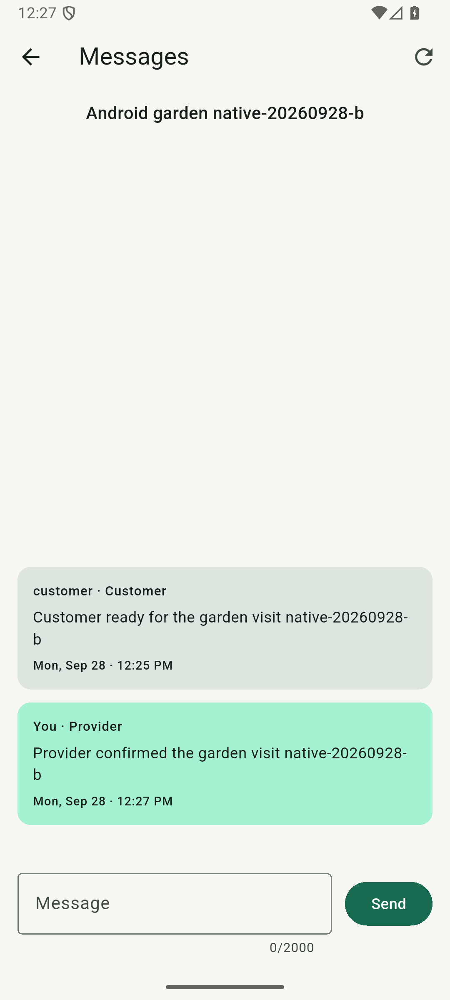
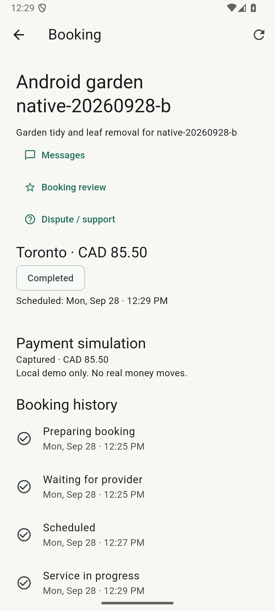
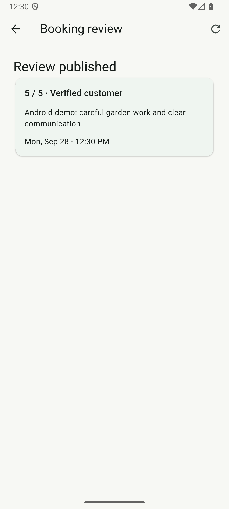

# Android request-to-review demo

This check drives the normal debug APK on the dedicated Bliss_Test/API 36 emulator
against local Keycloak, Quarkus and PostgreSQL. Every marketplace mutation goes
through Flutter UI controls. The driver does not seed a booking, change database
states, skip scheduling, or call mutation APIs directly. Payments remain simulated.

## Repeat the check

Start the local services from the root README and boot Bliss_Test with Chrome.
The generated customer/provider accounts must have profiles; the provider needs
an owned business, as described in [the marketplace setup](MARKETPLACE.md).
From the repository root with PowerShell 7:

```powershell
./infrastructure/scripts/test-android-oidc.ps1 -Scenario marketplace `
    -JavaHome 'C:\Program Files\Java\jdk-21'
```

The runner builds/installs the normal app and standalone test driver, checks the
local services, and stages generated credentials privately with host/device cleanup
in `finally`. It accepts only the dedicated Bliss_Test emulator. A unique run ID
is generated by default; `-RunId your-unique-id` makes it explicit. The check creates
local demo data and leaves it available for inspection. Existing run IDs are
rejected before creating another request. No app, database or browser data is reset.

The driver:

1. Signs in as customer and creates a Toronto gardening request with CAD 95.50 budget.
2. Signs in as provider and quotes CAD 85.50 for the work.
3. Returns as customer, accepts the quote and sends a booking message.
4. Returns as provider, reads the message, replies and accepts the booking with
   the app's default schedule. It waits for the actual scheduled time, starts the
   service, then marks the work complete.
5. Returns as customer, confirms completion and verifies simulated capture.
6. Force-stops/reopens Bliss, restores the customer session, and reopens the same
   booking and both chat messages.
7. Publishes a five-star review, returns through Back and reopens the saved review.
   It backgrounds/resumes the app, verifies the review remains visible, then
   force-stops/reopens and signs out.

The host allows up to ten minutes for instrumentation, including the real
scheduling wait. Success requires `OK (1 test)` and the final signed-out checkpoint.
Logs and app-only screenshots stay in ignored `.work/native-marketplace/<run-id>-all`.
Failures capture the app screen/hierarchy only when Bliss is foreground, never the
browser credential form. Inspect an uncertain run before repeating a mutation.

For diagnosis, `-MarketplacePhase request|quote|accept|fulfil|review` runs only that
phase against an existing run ID (except request, which creates a new one). These
are state-dependent debugging steps, not automatic retries; only a successful
`all` run establishes end-to-end coverage. Choose the next appropriate phase after
inspecting the persisted state. Replaying a completed phase is not supported.

## Evidence and limits

The initial development run completed the booking and published/reopened its
review. It then failed a driver assertion because Android exposes the review card
as one combined accessibility label. The driver now asserts the rating/comment
within that label. Earlier driver corrections use Android hint labels for Flutter
fields and explicitly focus inputs before editing; neither required a product change.
The duplicate-run guard was verified against that persisted request.

On September 28, 2026, the fresh `native-20260928-b` run passed all steps in
375.264 seconds (`OK (1 test)`) and finished signed out. The unchanged authentication
scenario also passed after the shared-driver extraction in 48.438 seconds.
Generated input cleanup completed; the host credential file was absent afterward.

A read-only PostgreSQL check of booking `7b70abb8-7f79-41c9-909b-89cbdce593a3`
confirmed `COMPLETED`, `CAPTURED`, exactly one authorization and capture, two chat
messages and one review. Its persisted workflow ID is `01M3MDCMJAS2QVNY6V7V5RCTYP`.
These are observations of the UI-created result, not fixture writes.

The actual emulator screenshots below were visually reviewed before inclusion.
They contain generated local demo data, without credentials or tokens.

| Provider reads and replies | Customer completion and capture | Reopened saved review |
| --- | --- | --- |
|  |  |  |

The existing [Android authentication regression](ANDROID.md) remains a separate
check of customer/provider recovery, logout and account switching. CI compiles
all native scenarios; local live-service execution is not represented as a CI emulator run.

This checks the primary quote-booking lifecycle. Direct booking/cancellation,
native admin/dispute screens and catalog outage/retry have
[separate drivers and evidence](ANDROID_SECONDARY.md). The [iOS simulator
marketplace run](IOS_MARKETPLACE.md) now passes the primary quote lifecycle.
Secondary iOS paths, physical-device coverage and signed distribution remain unverified. The app-process
restart does not restart the backend; backend workflow restoration is covered by
the separate packaged-process tests and browser demonstration.
