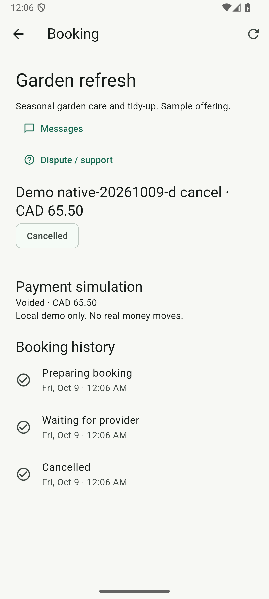
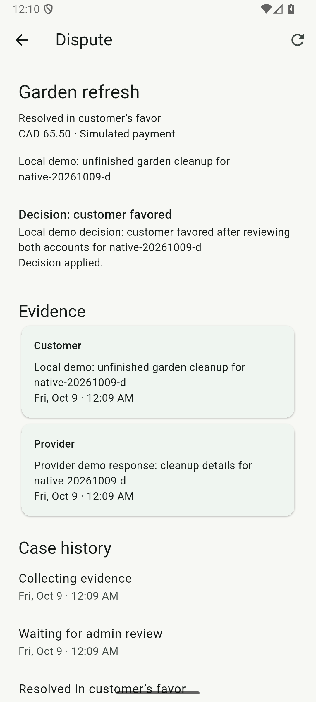
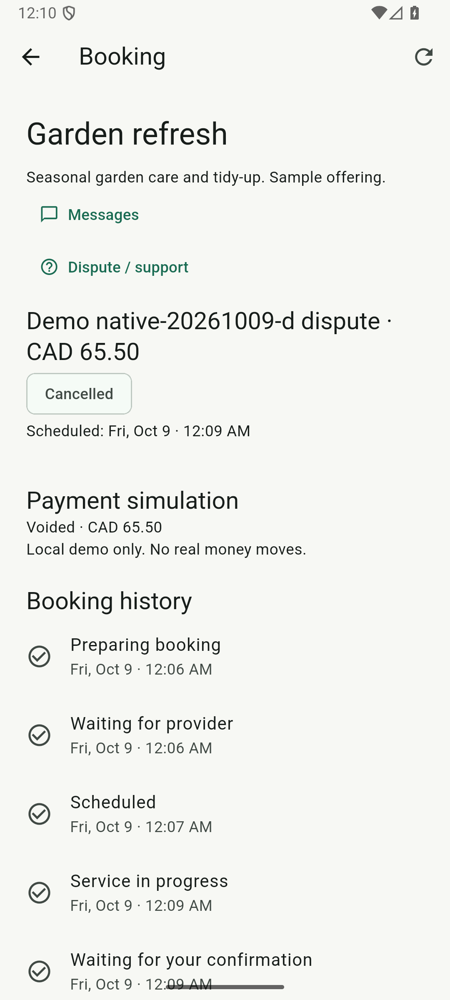
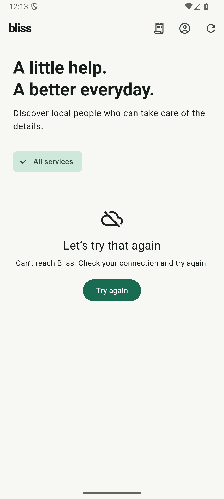
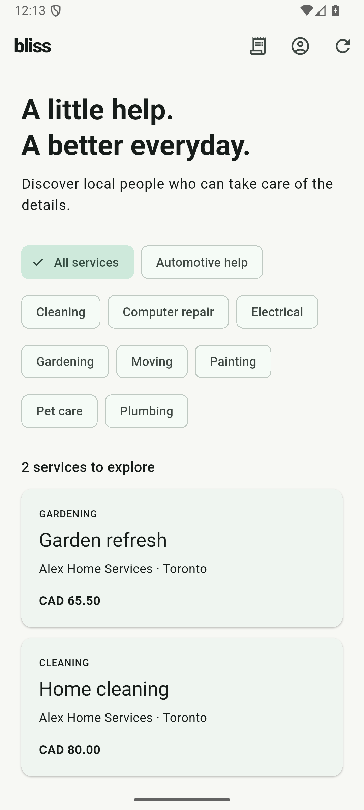

# Android direct booking, disputes and connection recovery

These checks run the normal debug APK on the dedicated Bliss_Test emulator
against local Keycloak, Quarkus and PostgreSQL. Payment operations are simulated.
No marketplace mutation uses an API shortcut or database fixture update.

## Direct booking and manual dispute

Start the local services and Bliss_Test as in [the Android setup](ANDROID.md).
The generated customer, provider and admin identities must have Bliss profiles;
the provider needs an active owned offering. The runner reads its title, category
and decimal price from PostgreSQL without changing it. From the repository root
using PowerShell 7:

```powershell
./infrastructure/scripts/test-android-oidc.ps1 -Scenario secondary `
    -JavaHome 'C:\Program Files\Java\jdk-21'
```

The driver creates two direct bookings through the catalog. Distinct service-city
markers containing a unique run ID distinguish them from existing demo bookings.
It cancels the first, checks the simulated void, restarts the app and reopens it.
The second is accepted/scheduled by the provider, started at its actual scheduled
time and marked complete. The customer files a dispute while settlement is still
authorized, the provider adds evidence, and an independent admin reads both parties'
accounts before choosing Customer favored. The customer reopens the applied
decision and voided payment after background/resume and app-process restart.
A successful full run finishes signed out.

The runner refuses an existing booking marker before creating another booking.
It supplies generated local credentials privately and removes staged host/device
inputs in `finally`. Results remain under `.work/native-secondary/<run-id>-all`.
Full instrumentation is bounded to fifteen minutes, including the scheduling wait.
Failures capture only Bliss screens, never browser credential forms.

`-SecondaryPhase cancel|create|fulfil|file|evidence|resolve|check` is available for
diagnosis with an explicit `-RunId`. These are state-dependent phases, not blind
retries. Inspect the persisted state first; an already-completed mutation phase
must not be replayed. Only a successful `all` run establishes end-to-end coverage.
The admin list is newest first, and the driver verifies the unique case reason
before submitting a decision. Do not edit offerings or run another UI driver
concurrently on the test emulator.

## Connection failure and recovery

```powershell
./infrastructure/scripts/test-android-oidc.ps1 -Scenario connectivity `
    -JavaHome 'C:\Program Files\Java\jdk-21'
```

This check uses no account credentials. After building/installing the app and
driver, the host removes only Bliss_Test's reverse mapping for API port 8088.
The first instrumented method launches the app and verifies the catalog error and
Try again action. The host restores the mapping in `finally`, even if that assertion
fails. A second method presses Try again on the same screen and requires real
offering data to return, without restarting Bliss. Keycloak's mapping and the
host backend remain running throughout. Each method has a two-minute limit.
Logs and screenshots stay under `.work/native-connectivity/<run-id>`.

## Evidence and limits

On October 9, 2026, the fresh `native-20261009-d` full run passed in
303.93 seconds (`OK (1 test)`) and finished signed out. It completed every
checkpoint described above. Read-only PostgreSQL inspection confirmed both
bookings were `CANCELLED` with `VOIDED` payments, exactly one AUTHORIZE and VOID
per booking, and no CAPTURE or REFUND. The dispute was `RESOLVED_CUSTOMER`, with
one provider evidence item and one applied independent admin decision.
The UI-created booking IDs are `e4bd0273-5266-4ccc-8ee0-3bb937ced09c` (cancel)
and `ed20669e-41f6-4fff-abb4-848c6283bdd2` (dispute).

The saved October 5 run had reached the applied decision but lacked a final
instrumentation result; its state-dependent `check` phase passed in 45.269 seconds
on October 9. A later fresh run stopped while the admin form was opening. The
driver now waits for the Outcome control; neither partial run is counted as a
full-flow pass. The earlier account-switch failure also led to waiting for enabled
Sign in after identity-provider logout, rather than merely a visible label.

The `native-20261009-outage-b` connection check passed both methods: unavailable in
3.589 seconds and same-screen retry recovery in 1.533 seconds. The
host API remained healthy and the emulator mapping was restored. The separate
real Keycloak authentication scenario passed again in 51.846 seconds after the
shared-driver change. Staged host/device credential inputs were absent afterward.
The first outage assertion missed Flutter's combined heading/message semantics;
the corrected selector matches that heading within the combined label and checks
its absence after recovery.

These actual app-only screenshots were reviewed before inclusion. They show
generated local demo data without credentials or tokens.

| Direct cancellation | Admin decision applied | Customer payment voided |
| --- | --- | --- |
|  |  |  |

| API disconnected | Same-screen retry recovered |
| --- | --- |
|  |  |

These checks complement [the primary Android flow](ANDROID_MARKETPLACE.md) and
[authentication recovery](ANDROID.md). CI compiles the native scenarios; real
emulator/service execution is a separate local gate.

The dispute scenario covers a manual customer-favored decision before capture,
resulting in an authorization void. Captured-payment refunds, provider-favored
decisions, timeouts and fault recovery have separate API/web evidence; this run
does not claim every settlement branch on Android. The connectivity check covers
public catalog recovery from connection failure, not uncertain mutation retries.
iOS, physical-device coverage and signed distribution remain unverified.
