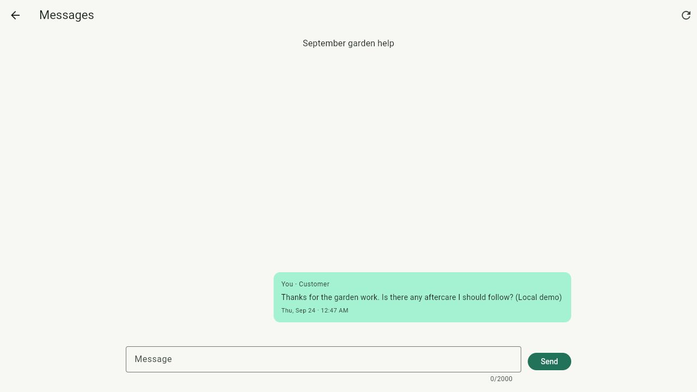
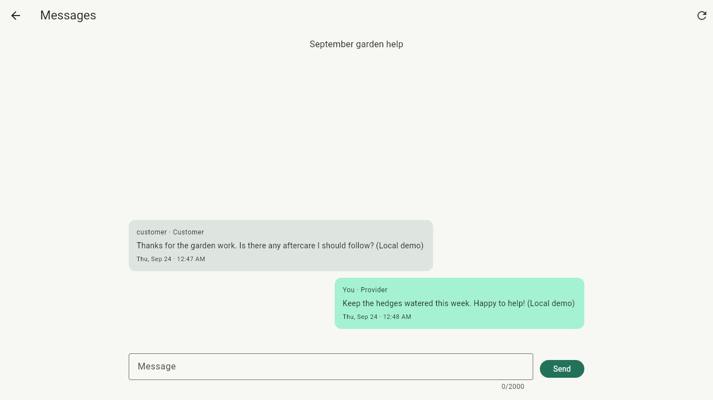
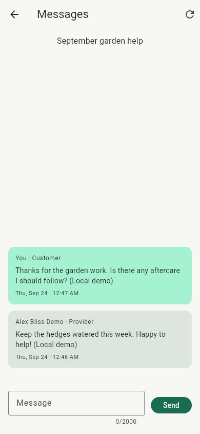

# Booking chat demo

Verified September 24, 2026 against local PostgreSQL 17.6, Keycloak, Quarkus and
the Flutter release web build. Use the root README to start the services. Generated
demo passwords stay in ignored `.work/demo-accounts.json`.

1. Sign in as `customer`. Open Your activity → Bookings → an owned booking → Messages.
2. Send a plain-text message. The first open creates one conversation for the
   booking, its customer and the provider's current OWNER identities.
3. Sign out and sign in as the assigned `provider`. Open Your activity → Messages,
   select the booking and reply. Verify the customer's message and your reply.
4. Stop and restart only the Bliss API, preserving PostgreSQL/Keycloak. Once API
   readiness returns, sign back in as the customer and reopen the conversation
   through the Messages list. Both messages must remain in order.
5. Check at a 390 × 844 browser viewport: sender, body, time and composer remain usable.

Actual evidence: the completed “September garden help” booking received a customer
aftercare question and provider reply. The API process was stopped and restarted;
the customer then signed in again and loaded both persisted messages in a fresh
chat screen. One login attempted during startup failed safely and succeeded after
readiness returned. Screenshots use generated demo accounts only.

Automated verification: Maven verify passed 43 regular tests plus three packaged
restart/migration scenarios. Six conversation scenarios cover participants,
capability loss, ownership revocation/replacement, third-party/admin denial,
malformed input, concurrent first open/send, idempotency and stable bounded cursors.
All 28 Flutter tests pass; six chat tests cover typed text, errors/retry, polling
without skipped messages, older pagination, access loss and logout during a send.
Formatting, analysis and release web build passed.

This first version is booking-only and remains available after booking completion
or cancellation. Current authorized participants can read the whole conversation.
New business owners do not automatically inherit it; revoked owners lose access.
There is no pre-booking chat, attachment, push delivery, read receipt, edit/delete,
participant invitation or realtime transport. Polling runs every three seconds
while the route is visible. Unconfirmed sends retain their original key/text in
memory; after reloading the app, read history before deciding to resend.
Later [Android authentication](ANDROID.md) verifies real login/recovery/logout;
[native marketplace evidence](ANDROID_MARKETPLACE.md) records the Android booking
chat check. The [iOS marketplace run](IOS_MARKETPLACE.md) also verifies two-way
chat and app-process recovery. This page's backend-restart demonstration remains web-only.
