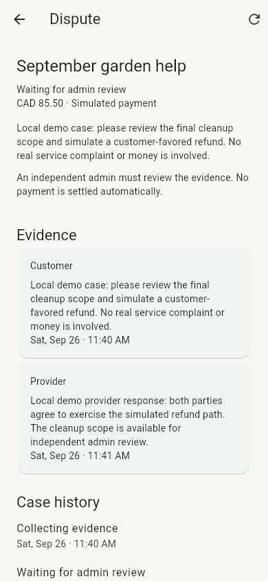
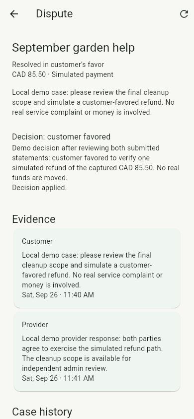
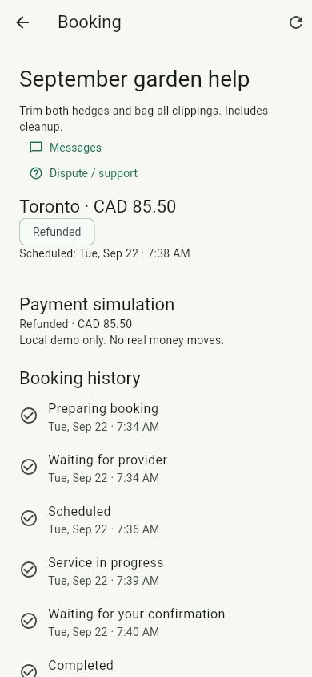

# Manual dispute demo

Local portfolio workflow only; every payment operation is simulated. Start the
documented PostgreSQL, Keycloak, API and Flutter web services. Use separate demo
customer, assigned provider and independent admin identities; credentials stay in
ignored local files.

1. Complete a booking as far as provider mark-complete (WAIT_CUSTOMER), or let its
   customer confirm completion (COMPLETED). Within seven days of mark-complete,
   the customer opens Booking → Dispute / support and explains the issue.
2. The case displays Collecting evidence and its saved 24-hour deadline. Opening
   reason is the customer's initial evidence. Booking settlement is paused.
3. Sign in as the assigned provider → Your activity → Disputes → case → Add
   evidence. Once both parties have contributed, Flow moves to manual review.
   If a party never responds, deadline expiry opens review without picking a winner.
4. Sign in as an independent admin → Your activity → Disputes → read evidence →
   Resolve dispute. Select Customer favored or Provider favored and give a rationale.
   The submitted decision is pending until Flow commits settlement.
5. Reopen as the customer. Customer favored refunds a captured payment or voids
   its authorization; provider favored captures an authorization or retains an
   existing capture. The case and booking timelines show the outcome.

## Recovery and policy boundaries

Case, evidence, decision, histories and workflow start intent are durable. The
packaged-process tests forcibly stop the API during evidence collection and
admin review, restore the same instance, then assert one final settlement.
The ordinary tests exercise all three money operations, duplicate submissions,
concurrent decisions, expired filing/evidence windows, unauthorized access and
transient failures after a ledger write (transaction rollback).

After four failed settlement attempts, the case remains unresolved and its saved
decision unprocessed. A durable FAULTED marker shows that support is needed;
automatic redispatch is disabled. No self-service operator recovery is claimed.
The Flow dependency deletes failed checkpoints; this marker is a Bliss listener,
not an upstream source modification.

Only current provider owners can act; other members cannot submit evidence.
An admin related to either side cannot decide. Text evidence is shared with both
parties and admins, with no uploads or automated adjudication. Evidence closes
when both parties have submitted or the deadline passes. No appeals/reopening,
editing/deletion or moderation is implemented. A previously published review
remains public after a refund. Native device authentication remains unverified (#7).
Migration V9 preserves existing data but new booking states require a forward
migration plan if reverting application versions.

## Verification evidence

Local checks passed on September 25: Maven `spotless:apply verify` ran 55 ordinary
scenarios and five packaged/migration scenarios (60 total, zero failures/skips).
Flutter analysis, all 39 tests and release web build passed. The six new widget
tests cover opening/reopening, evidence and decision retries, asynchronous
settlement, fault/access-loss states, paging and logout during a pending request.

On September 26, the real browser with PostgreSQL/Keycloak/API verified customer
filing on the completed September garden help booking, provider evidence, admin
review/decision, polling to resolution, customer re-login and case reopening.
At 390 × 844 the case and booking show a simulated CAD 85.50 refund. The database
contains exactly one AUTHORIZE, one CAPTURE and one REFUND for that booking.
V9 upgraded the existing database without resetting bookings/chat/reviews.
No browser console errors were present at the final check.

CI/merge references are recorded in [the progress log](../agent/PROGRESS.md).
