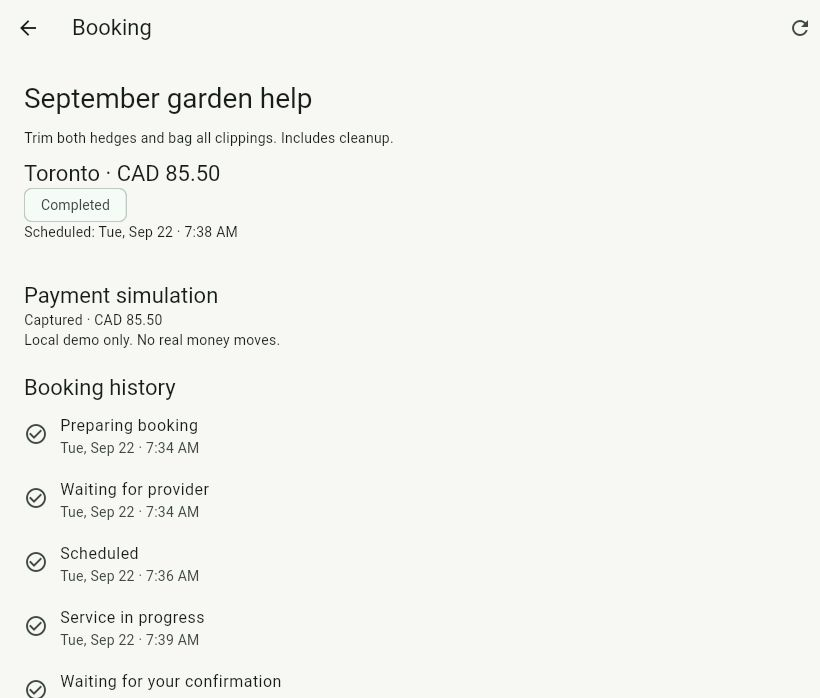
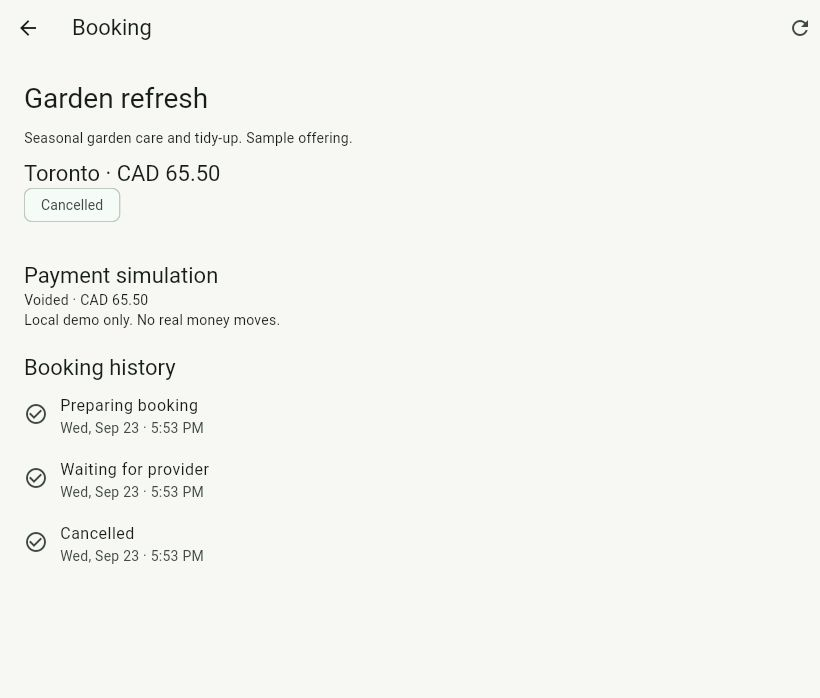
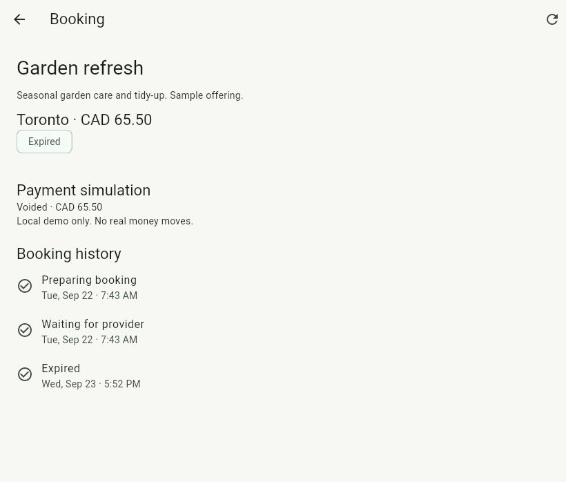
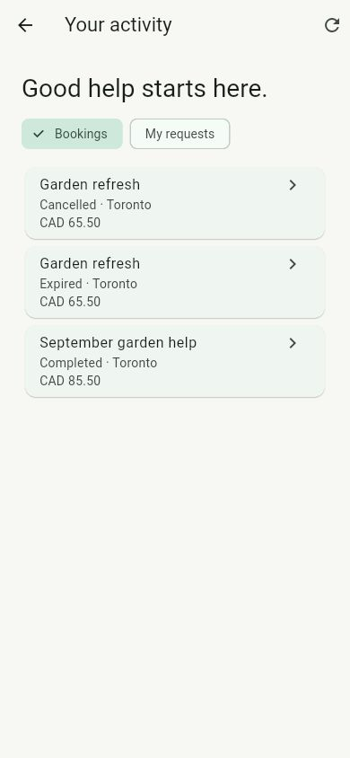

# Flutter marketplace demo

Use the local API, PostgreSQL and Keycloak setup in the root README, and serve the
Flutter web app at localhost:3000. Demo credentials are generated in the ignored
`.work/demo-accounts.json`; never include them in screenshots or commits.

## Request and quote path

1. Sign in as `customer`, open **Your activity → My requests → Create request**.
   Enter a title, scope, city, category, currency and optional budget.
2. Sign out through **Your account** and sign in as `provider`. Open
   **Your activity → Open opportunities**, select the request and **Send quote**.
   Choose an owned business, describe the scope and enter an exact decimal price.
   Quotes remain valid for seven days. **My quotes** lists the result per business.
3. Sign in as `customer` again, open the request and review the provider, scope,
   price and expiry. **Accept quote** creates the booking and opens its timeline.
4. As `provider`, open **Your activity → Bookings → Accept and schedule**. Choose
   a future local time. **Start service** appears when that time arrives; then
   **Mark work complete** hands the decision to the customer.
5. As `customer`, use **Confirm completion**. The workflow completes the booking
   and captures its simulated authorization. No real money moves.

The September 22, 2026 browser run created “September garden help”, quoted CAD
85.50, scheduled it, waited until the scheduled time, started and completed work,
and confirmed it as the customer. The final screen showed **Completed** and
**Captured · CAD 85.50**, with the full persisted history. Every mutation in that
flow used the visible Flutter UI against the real API and Keycloak.

## Direct offering path

Open a catalog offering as a customer, select **Request booking**, review its
scope/price/provider, enter the service city and submit. The server uses the
reviewed offering revision and owns the price snapshot. Eligible bookings can be
cancelled from the booking screen, with confirmation and simulated voiding.

On September 23, the previous day's unanswered direct booking restored after the
local stack restart, expired at its overdue provider deadline and displayed
**Voided · CAD 65.50**. A fresh direct booking was then created and cancelled
through the UI, ending **Cancelled** with the same simulated void. The completed
quote booking remained in the list. A 390-pixel-wide browser check verified the
offering details and activity list layout; this is not a native-device test.

## Reliability and verification limits

The client polls a visible, active booking every three seconds, updates on state
changes, and stops polling terminal bookings. Accepted events show a waiting state
until the durable workflow advances. Retry keys preserve an uncertain booking or
action submission during the current session. Inputs cannot change during that
retry. After a reload or logout, check the booking list before creating another.
Request creation does not offer a blind retry after an uncertain response.

Flutter analysis and release web compilation pass. The 22 unit/widget tests cover
mapping, action availability, quote acceptance, direct-booking payloads, stable
retry keys, pagination/error recovery, deferred workflow updates, access loss,
logout, late responses and retrying an already processed workflow event without
leaving the UI waiting. Existing account, catalog and provider tests also pass.
Backend contracts and authorization remain server-enforced; this change adds no
backend routes or migrations.

This September 22–23 evidence covers Flutter web. Later
[Android authentication](ANDROID.md) verifies real browser login/recovery/logout;
the separate [Android marketplace run](ANDROID_MARKETPLACE.md) records native
lifecycle verification. The [iOS simulator marketplace run](IOS_MARKETPLACE.md)
now also passes request-to-review with real local services. No production
release is claimed. [Chat](CHAT.md) and [reviews](REVIEWS.md) have separate
demo evidence; [disputes](DISPUTES.md) now include the manual admin/refund path.
