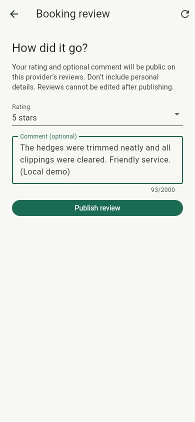
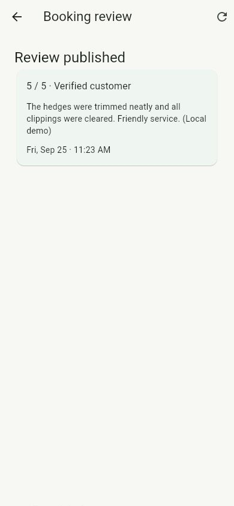
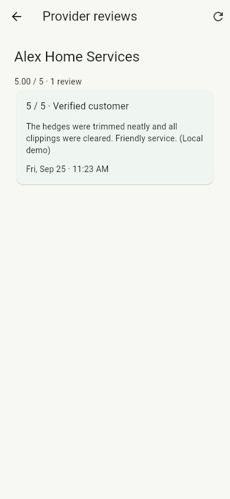

# Completed-booking reviews demo

Verified September 25, 2026 against local PostgreSQL 17.6, Keycloak, Quarkus and
the Flutter release web build. Start services using the root README; generated
demo credentials remain in ignored `.work/demo-accounts.json`.

1. Without signing in, open an offering → Provider reviews. A provider with no
   reviews shows “No reviews yet.”
2. Sign in as the customer who completed the booking. Open Your activity → Bookings
   → the completed booking → Booking review.
3. Choose a rating from 1–5 and optionally add a comment. The form explains that
   the rating/comment are public and cannot be edited. Publish the review.
4. Return to the booking and reopen Booking review: the saved review appears,
   with no second submission form.
5. Sign out. Open that provider's offering → Provider reviews. Verify the public
   average, count and comment; no customer name or booking information is shown.

Actual browser evidence: the previously completed “September garden help” booking
received a five-star local demo review. Reopening showed the same saved review.
Signed-out discovery showed Alex Home Services at **5.00 / 5 · 1 review** with the
same comment. Empty state, form and saved/public views were checked; form and
review layout passed at 390 × 844. The browser reported no console errors.

Verification: Maven verify passed 48 regular tests and three packaged migration/
restart scenarios. Five review scenarios cover all non-completed states, customer
ownership/capability, anonymous/provider/admin/outsider rejection, malformed input,
concurrent duplicates, database uniqueness, public privacy, pagination and aggregate
accuracy. Fixture state changes isolate review policy; the separate lifecycle tests
prove real transitions to completion. Flutter formatting/analysis, all 33 tests and
release web build pass. Five UI tests cover validation, lost-response retries,
ineligibility/conflict recovery, logout during a late submission and public paging.

V8 adds only the review table/index; upgrading the existing demo database preserved
bookings and conversations. One immutable review is allowed per completed booking.
Identical normalized retries return the same review; changed duplicates return 409.
Public averages use all of a provider's reviews and are not limited to the page.
The “Verified customer” label means a completed booking, not identity verification.

Review editing/deletion, provider replies, moderation/reporting and retention are
not implemented. Production abuse/privacy policies remain #15.
[Android authentication](ANDROID.md) and [native marketplace verification](ANDROID_MARKETPLACE.md)
have separate evidence; [iOS marketplace verification](IOS_MARKETPLACE.md) now
also covers publishing and reopening the saved review after process recovery. Manual-admin disputes are documented
in [the dispute demo](DISPUTES.md).
